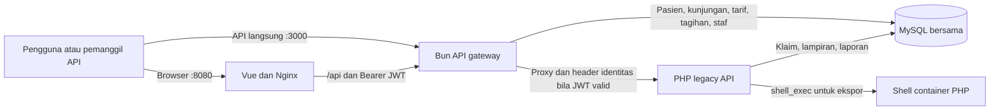
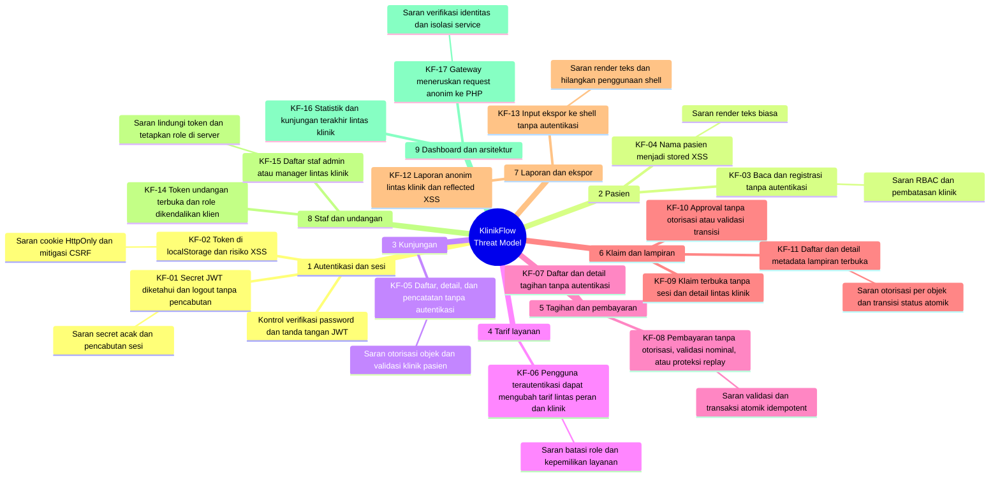

# Threat Model: KlinikFlow

> **Baseline historis:** temuan di bawah mendokumentasikan kondisi sebelum perbaikan. Kode telah diperbarui untuk mengatasi KF-01 sampai KF-17; lihat README untuk konfigurasi baru dan pengujian regresi. Gambar mind map serta dokumen Word versi 2 juga menggambarkan baseline ini, bukan status sistem saat ini.

## Ruang Lingkup

KlinikFlow adalah lab pelatihan lokal dengan data sintetis, bukan aplikasi produksi. Dokumen ini memetakan alur modul, batas kepercayaan, risiko, dan rekomendasi berdasarkan **analisis statis kode**, bukan pengujian eksploitasi atau audit menyeluruh. Prioritas menggambarkan risiko apabila pola yang sama digunakan di lingkungan nyata; bukan penilaian CVSS formal. Kerentanan yang sengaja disediakan untuk latihan tidak diubah.

**Aset:** identitas dan informasi administrasi pasien, catatan kunjungan, tarif, tagihan dan pembayaran, klaim dan metadata lampiran, akun staf, token undangan, dan sesi pengguna.

**Aktor:** pengguna anonim yang dapat mengakses API, pasien, staf, kasir, manajer, admin, dan pihak yang dapat menjangkau jaringan internal container. Hak lintas klinik harus bergantung pada kebijakan organisasi, bukan sekadar identifier dari klien.

## Alur Sistem

**Batas kepercayaan:** browser dan pemanggil API ke gateway; gateway ke PHP melalui header identitas; kedua layanan ke MySQL; dan input ekspor ke shell. PHP tidak dipublikasikan sebagai port host dalam konfigurasi Compose, tetapi dapat dijangkau dari jaringan internal; gateway sendiri dipublikasikan pada port 3000. Referensi: [docker-compose.yml](docker-compose.yml), [proxy.ts](bun-api/src/proxy.ts), [nginx.conf](web/nginx.conf).

## Peta Ancaman

Label **[ADA]** menunjukkan kontrol yang terlihat pada kode, bukan jaminan keamanan menyeluruh. **[SARAN]** berarti belum terlihat diterapkan. Nomor KF mengacu pada rincian di bawah.

## Temuan dan Rekomendasi

### Autentikasi dan sesi

**KF-01 | Kritis | Secret JWT diketahui dan logout tidak mencabut token.** `JWT_SECRET` memiliki fallback yang tertulis di sumber dan nilai yang sama di Compose. Pihak yang mengetahui secret dapat membuat JWT dengan klaim peran atau klinik pilihan. Logout hanya mengembalikan respons sukses; token yang sudah diterbitkan tetap berlaku sampai kedaluwarsa. **[ADA]** Login menggunakan verifikasi hash password, pesan kredensial generik, tanda tangan JWT, dan masa berlaku 24 jam. **[SARAN]** Gunakan secret acak dari secret manager, rotasi secret, verifikasi kebijakan algoritma, serta sesi yang dapat dicabut atau token berumur pendek. Referensi: [auth.ts](bun-api/src/auth.ts), [index.ts](bun-api/src/index.ts), [docker-compose.yml](docker-compose.yml).

**KF-02 | Tinggi | Token browser dapat dibaca JavaScript.** Token disimpan di `localStorage`; XSS seperti KF-04 atau KF-12 dapat membaca token sesi. **[SARAN]** Pertimbangkan cookie `HttpOnly`, `Secure`, dan `SameSite` disertai proteksi CSRF, serta hilangkan sumber XSS. Referensi: [api.ts](web/src/api.ts).

### Pasien dan kunjungan

**KF-03 | Kritis | Identitas pasien dapat dibaca dan dibuat tanpa sesi.** `GET /api/patients` mengembalikan seluruh klinik; `POST /api/patients` tidak memeriksa identitas atau hak dan menerima `clinic_id` dari klien. Dampaknya meliputi kebocoran dan pemalsuan data administratif. **[ADA]** Pencarian menggunakan parameter SQL dan pendaftaran memeriksa sejumlah field wajib. **[SARAN]** Wajibkan autentikasi, role dan cakupan klinik di server, serta validasi input. Referensi: [patients.ts](bun-api/src/patients.ts).

**KF-04 | Kritis | Stored XSS melalui nama pasien.** Nama dari pendaftaran disimpan dan dirender melalui `v-html` pada daftar pasien. Pemanggil dapat menanam markup yang dieksekusi ketika pengguna lain membuka daftar. **[SARAN]** Gunakan interpolasi teks Vue, bukan HTML mentah; tambahkan CSP sebagai pertahanan tambahan. Referensi: [patients.ts](bun-api/src/patients.ts), [Patients.vue](web/src/views/Patients.vue).

**KF-05 | Kritis | Kunjungan dapat dibaca dan dibuat tanpa sesi.** Endpoint daftar dan detail mengembalikan data lintas klinik, termasuk telepon dan alamat pada detail. Pembuatan menerima `clinic_id` dan `patient_id` tanpa pemeriksaan kesesuaian klinik atau kewenangan. Identifier kunjungan bukan kontrol akses. **[SARAN]** Periksa identitas, role, kepemilikan pasien dan klinik pada setiap query; gunakan identifier acak yang kuat sebagai pertahanan tambahan. Referensi: [visits.ts](bun-api/src/visits.ts), [index.ts](bun-api/src/index.ts).

### Layanan, tagihan, dan pembayaran

**KF-06 | Tinggi | Perubahan tarif melampaui peran dan klinik.** `POST/PUT /api/services/fee` dan aliasnya memerlukan JWT valid, tetapi tidak membatasi role atau mencocokkan klinik dengan layanan; pasien sekalipun dapat mengubah tarif. **[ADA]** Nilai negatif dan input numerik yang tidak valid ditolak. **[SARAN]** Batasi perubahan kepada role yang berwenang, scope berdasarkan klinik, dan audit perubahan. Referensi: [services.ts](bun-api/src/services.ts).

**KF-07 | Kritis | Tagihan dan riwayat pembayaran terbuka.** Daftar dan detail invoice tidak memeriksa sesi atau kepemilikan; detail memuat identitas, alamat, item, dan pembayaran. **[SARAN]** Terapkan otorisasi role dan objek untuk setiap invoice, termasuk hubungan pasien dan klinik. Referensi: [invoices.ts](bun-api/src/invoices.ts).

**KF-08 | Kritis | Pembayaran dapat dimanipulasi dan diproses ulang.** `POST /api/payments/process` tidak memeriksa sesi, role, klinik, status awal, atau kesesuaian nominal dengan tagihan. Setiap panggilan yang diterima menambahkan pembayaran dan menandai invoice lunas; operasi insert dan update juga tidak dibungkus transaksi. Dampaknya berupa pencatatan pembayaran duplikat, pelunasan tidak sah, dan data tidak konsisten. Ini adalah simulasi pencatatan, bukan bukti transfer dana nyata. **[SARAN]** Validasi role dan kepemilikan, nominal serta metode; gunakan transaksi, penguncian/status bersyarat, dan idempotency key. Referensi: [invoices.ts](bun-api/src/invoices.ts).

### Klaim dan lampiran

**KF-09 | Kritis | Daftar dan detail klaim dapat diakses anonim.** Gateway meneruskan permintaan tanpa JWT; pada daftar, filter klinik hanya ditambahkan jika header klinik tersedia dan role bukan admin. Tanpa header, daftar mencakup semua klinik. Detail berdasarkan ID tidak memeriksa identitas atau klinik. **[SARAN]** Tolak identitas yang tidak ada dan tegakkan role serta kepemilikan di setiap query. Referensi: [proxy.ts](bun-api/src/proxy.ts), [claims.php](php-api/src/claims.php).

**KF-10 | Kritis | Approval klaim tanpa otorisasi atau validasi status.** `POST /api/claims/approve` dapat menyetujui klaim berdasarkan ID tanpa pemeriksaan role, klinik, atau status awal, termasuk pengulangan; invoice terkait ikut ditandai lunas. Kedua update tidak atomik. Respons menyebut pencairan, tetapi kode yang ditinjau tidak menunjukkan transfer dana atau pembuatan pembayaran. **[SARAN]** Batasi approver dan klinik, izinkan hanya transisi bisnis yang sah, gunakan transaksi atomik dan idempotensi, serta simpan audit. Referensi: [claims.php](php-api/src/claims.php).

**KF-11 | Tinggi | Metadata lampiran dapat dibaca tanpa otorisasi.** Daftar membuka UUID dan nama berkas lintas klinik; detail mengembalikan metadata, termasuk `file_path`, tanpa pemeriksaan pemilik. Handler yang ditinjau mengembalikan metadata JSON, bukan isi berkas. **[SARAN]** Otorisasi berdasarkan klaim dan klinik, serta hindari membuka path internal. Referensi: [attachments.php](php-api/src/attachments.php).

### Laporan dan ekspor

**KF-12 | Kritis | Laporan anonim lintas klinik dan reflected XSS.** Tanpa header klinik, laporan tidak memfilter klinik. Parameter `filter` disisipkan ke `summary_html`, lalu dirender dengan `v-html`; halaman mengisi filter dari query URL dan memuat laporan saat dibuka. **[ADA]** Filter query SQL diparameterisasi. **[SARAN]** Wajibkan autentikasi dan scope klinik; kirim dan render ringkasan sebagai teks. Referensi: [reports.php](php-api/src/reports.php), [Reports.vue](web/src/views/Reports.vue).

**KF-13 | Kritis | Command injection pada ekspor.** `type`, `filter`, dan `format` dikonkatenasi ke perintah yang dijalankan `shell_exec`; endpoint proxy tidak mewajibkan sesi. Input yang mengandung sintaks shell dapat menjalankan perintah di container PHP dengan hak proses web. **[SARAN]** Hilangkan shell dan bangun output menggunakan API bahasa; jika proses eksternal mutlak diperlukan, gunakan pemanggilan tanpa shell, allowlist argumen, otorisasi, dan pembatasan hak proses. Referensi: [export_report.php](php-api/src/export_report.php), [proxy.ts](bun-api/src/proxy.ts).

### Staf dan undangan

**KF-14 | Kritis | Token undangan terbuka dan eskalasi peran.** `GET /api/staff/invitations` mengembalikan token undangan yang belum diterima tanpa autentikasi. `POST /api/staff/accept-invitation` menerima `role` dari klien dan mengutamakannya di atas role undangan, sehingga token yang diperoleh dapat dipakai untuk membuat akun berperan admin. **[SARAN]** Jangan tampilkan token melalui daftar, batasi pengelola undangan, tetapkan role hanya dari undangan server, dan gunakan token sekali pakai yang kedaluwarsa dengan konsumsi atomik. Referensi: [staff.ts](bun-api/src/staff.ts).

**KF-15 | Sedang | Daftar staf melintasi klinik.** `GET /api/staff` membatasi role ke admin atau manager, tetapi query tidak membatasi klinik. Dampaknya bergantung pada apakah manajer berwenang melihat seluruh klinik. **[SARAN]** Tetapkan kebijakan akses lintas klinik secara eksplisit dan terapkan filter untuk role yang perlu dibatasi. Referensi: [staff.ts](bun-api/src/staff.ts).

### Dashboard dan batas layanan

**KF-16 | Tinggi | Dashboard mengungkap statistik dan kunjungan lintas klinik.** Setiap pengguna dengan JWT valid dapat melihat agregat seluruh klinik dan lima kunjungan terakhir beserta nama pasien. **[SARAN]** Batasi dashboard berdasarkan role dan klinik, termasuk daftar terbaru. Referensi: [index.ts](bun-api/src/index.ts).

**KF-17 | Kritis | Batas gateway ke PHP tidak menegakkan autentikasi.** `proxyToPhp` hanya menambahkan header identitas jika JWT valid, tetapi tetap meneruskan request jika tidak ada; beberapa handler PHP menganggap header yang hilang sebagai role `staff` dan tidak menolak request. Header identitas juga bukan bukti yang dapat diverifikasi secara mandiri oleh PHP jika service tersebut diakses langsung dari jaringan internal. **[ADA]** Gateway membangun header identitas baru, bukan meneruskan header identitas klien; PHP tidak memiliki port host pada Compose. **[SARAN]** Tolak request anonim sebelum proxy dan pada PHP, gunakan identitas antar-service yang terverifikasi, serta pertahankan isolasi jaringan. Referensi: [proxy.ts](bun-api/src/proxy.ts), [claims.php](php-api/src/claims.php), [reports.php](php-api/src/reports.php), [docker-compose.yml](docker-compose.yml).

## Contoh Rantai Risiko

1. Pemanggil anonim membaca undangan terbuka → menerima undangan dengan role admin → login sebagai admin → mengakses fungsi yang memeriksa role. Terkait KF-14 dan KF-15.
2. Pemanggil anonim membuat pasien dengan nama berisi markup berbahaya → pengguna membuka daftar pasien → skrip dapat membaca token dari `localStorage`. Terkait KF-03, KF-04, dan KF-02.
3. Pemanggil anonim mengakses gateway → ekspor diteruskan ke PHP → parameter mencapai shell → perintah berjalan dalam konteks container PHP. Terkait KF-17 dan KF-13.

## Urutan Penanganan yang Disarankan

1. Batasi paparan lab ke lingkungan lokal terisolasi; jangan gunakan konfigurasi atau data ini di produksi.
2. Hilangkan command injection dan XSS, tutup akses anonim, serta putar secret JWT dan undangan yang sudah terpapar.
3. Terapkan otorisasi role, klinik, dan kepemilikan objek secara konsisten di Bun dan PHP; definisikan pengecualian akses lintas klinik.
4. Amankan alur pembayaran, approval, dan undangan dengan validasi transisi, transaksi atomik, idempotensi, serta audit.
5. Tambahkan pengujian regresi untuk pengguna anonim, seluruh role, akses lintas klinik, input berbahaya, dan request berulang atau bersamaan.

**Batas verifikasi:** temuan disimpulkan dari kode dan konfigurasi yang dibaca; belum diuji melalui request runtime, browser, atau pengujian konkurensi. Infrastruktur, dependensi, dan seluruh kemungkinan kerentanan belum diaudit menyeluruh.